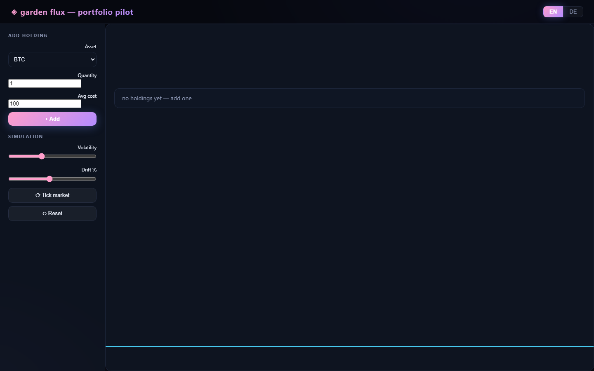
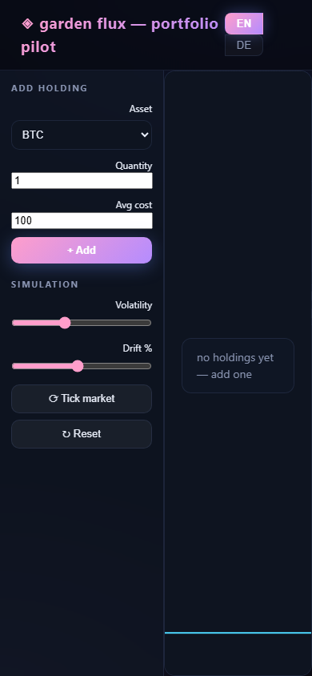

# Garden Flux — Portfolio Pilot

A simulated portfolio tracker for BTC/ETH markets: add holdings, watch a live random-walk price feed, canvas equity curve and allocation donut.

<div align="center">


**[Live Demo](https://ruslanfridenli.github.io/garden-flux/)** · **[Deutsch ↓](#-deutsch)**

</div>

---

## Screenshots






## Features

- Add/remove holdings with avg cost basis
- Simulated live price feed with volatility & drift controls
- Canvas equity curve + allocation donut
- Persistent storage via localStorage
- Auto-ticking market every 2.5s
- English/German interface

## Local development

```bash
git clone https://github.com/ruslanfridenli/garden-flux.git
cd garden-flux
# open index.html in a browser, or serve statically:
npx serve .
```

No build step, no dependencies — pure static site.

---

## 🇩🇪 Deutsch

### Garden Flux — Portfolio Pilot

Ein simulierter Portfolio-Tracker für BTC/ETH-Märkte: Positionen hinzufügen, Live-Zufallskurs-Feed, Canvas-Kurslinie und Allokations-Diagramm.

### Funktionen

- Positionen mit Ø-Kosten hinzufügen/entfernen
- Simulierter Live-Kursfeed mit Volatilitäts-/Drift-Reglern
- Canvas-Kurslinie + Allokations-Diagramm
- Speicherung via localStorage
- Automatischer Markt-Tick alle 2,5s
- Englische/deutsche Oberfläche

### Lokale Entwicklung

```bash
git clone https://github.com/ruslanfridenli/garden-flux.git
cd garden-flux
npx serve .
```

Reine statische Seite — kein Build-Schritt, keine Abhängigkeiten.

---

## ☕ Support / Unterstützen

Wenn dir diese Website beim Lernen hilft, würde mir eine Spende sehr viel bedeuten und dabei helfen, sie weiterzuentwickeln. Alternativ kannst du das Projekt mit einem Stern im github repo unterstützen. Vielen Dank!

- Solana: `zQpgZ6nGigww7vYpz3Qqxb1BT44kqS567vFaLTeHagS`
- Ethereum: `0x9c4fE1B2e9a1A9c22312c8296BB088Ca0e8F1B4e`
- Bitcoin: `bc1p2jltk9ya9kyzv35d8kxn7mmg9jqkx66cqtgzqwe75zlr4v9jk4hsv468q7`

---

Made with care. Feedback welcome via issues.
